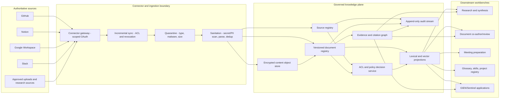

# GIEN / OneFineStarstuff Knowledge Plane — Foundation 1.0.0

**Status:** Proposed architecture and data-contract baseline; review required  
**Implementation scope:** Versioned schemas, synthetic fixtures, validator, and CI integration  
**Operational status:** This change enables no production connector, content store, retrieval service, or live data path.

## 1. Decision and boundary

Establish one shared knowledge plane for the portfolio rather than another standalone governance application. It is the governed system of record for source identity, document versions, access-control snapshots, data-governance metadata, provenance, lifecycle, and claim-to-source evidence references. GIEN, Sentinel, Nexus Forge, research/report tooling, and meeting workbenches consume its APIs and events; they must not create competing canonical source records.

This first release deliberately does **not** implement OAuth, connector polling, parsing, malware scanning, PII detection, object storage, embeddings, search, an API, or a production database. It introduces reviewable contracts and deterministic validation before any connector or content-processing code ingests real information.

## 2. Canonical records

| Record | Identity | Purpose | Must not contain |
|---|---|---|---|
| Source record | `source_id` | Connector/source identity, source revision and digest, owner, ACL state, lawful-purpose metadata, provenance and lifecycle | OAuth tokens, passwords, raw secrets, copied document contents |
| Document version | `document_id` + `document_version_id` | Specific normalized content object, digest, extraction/redaction metadata, current ACL snapshot and lifecycle | Raw extracted text, credentials, public object-store URLs, ungoverned embeddings |
| Evidence reference | `evidence_id` + `claim_id` | Bind a claim to an exact source and document version, content digests, locator and evidence status | Unsupported claims, assurance beyond the source, copied passages as a substitute for traceable citations |

Stable IDs are immutable. Updates create a new version or lifecycle event; they do not overwrite the history needed to explain a previous answer. Source revision, document digest, parser/extractor version, policy version, and citation locator travel with every derived claim.

### Evidence vocabulary

- `SIMULATED`: synthetic or hand-authored demonstration material.
- `UNVERIFIED`: registered but not checked by a defined verification procedure.
- `OBSERVED`: collected from an identified source, with collection time and traceable identity.
- `VERIFIED`: a named, versioned verification procedure passed against identified inputs and retained evidence.
- `INDEPENDENTLY_ASSURED`: a competent independent reviewer issued a traceable result for a stated scope.

These labels are not interchangeable. Regulator-accepted or regulator-approved states are intentionally absent. A source hash establishes byte identity, not authorship, truth, regulatory acceptance, or tamper-proof retention. A production signature or independent assurance statement requires its own verification and trust chain.

## 3. Reference architecture



**Authorization invariant:** identity and tenant context are established before retrieval; policy filters candidate documents before text or embedding content is returned; authorization is rechecked before each passage reaches a model, user, or downstream tool. Post-generation filtering is not acceptable. Unknown, stale, or revoked ACL state fails closed. Cache keys include tenant, principal/entitlement version, policy version, and source ACL snapshot; revocation invalidates affected cache entries and projections.

## 4. Ingestion and acceptance sequence

1. **Connector authorization:** approved installation and least-privilege OAuth scopes. Store credentials only in a managed secrets system. Never put them in source URIs, records, logs, fixtures, or build artifacts.
2. **Source discovery:** register connector instance, external object ID, tenant, owner, source revision, source ACL snapshot, jurisdiction, license/data-rights state, and documented processing purpose.
3. **Quarantine:** allow-listed formats; decompression/archive-depth and file-size limits; malware scanning; parser isolation; content-type sniffing. Failed or unknown checks remain quarantined.
4. **Sanitation:** classify personal data and secrets, redact where authorized, deduplicate by digest, normalize safely, and record parser/extractor versions. Untrusted source text is data, never executable instructions.
5. **Registry commit:** create immutable source and document-version records. Store originals in encrypted governed storage with separate key references, retention controls, and deletion workflow.
6. **Index projection:** create lexical/vector projections only after registry, rights, ACL, sanitation, and provenance gates pass. Indexes are disposable projections, not the system of record.
7. **Retrieval and generation:** enforce ACL and purpose filters before retrieval; retain exact document-version digests and locators in evidence references; refuse to present unsupported claims as facts.
8. **Revocation and deletion:** ACL removal, connector disconnect, retention expiry, data-subject request, or owner action triggers a workflow across objects, parsed text, chunks, embeddings, caches, generated derivatives, and exports. Keep only a lawful minimal tombstone/audit record where applicable.

## 5. Privacy and data-rights requirements

- Define a documented purpose per source and workbench; purpose changes require review. Do not ingest a connector merely because an API is available.
- Determine controller/processor roles, Article 6 lawful basis, and, where applicable, Article 9 condition before processing personal or special-category data. A legitimate-interests basis must point to a completed assessment. The schema records references; it does not determine legal compliance.
- Complete a DPIA where processing is likely to result in high risk. Record categories, recipients, transfer destinations, retention, safeguards, and residual risks.
- Minimize collection and derived copies. Private messages, calendar content, and personal preferences are not ingested by default; each connector scope and purpose needs approval.
- Mirror source ACLs and revoke access promptly. Never infer permissions from repository visibility or UI role labels alone.
- Enforce retention and deletion across raw objects, parsed text, embeddings, caches, generated derivatives, and exports. Legal holds must be explicit, scoped, reviewed, and auditable.
- Provide data-subject workflows for access, correction, restriction, objection, portability, and erasure where applicable; document lawful exceptions and controller decisions.
- Keep personal preferences in a separate, consent-driven profile service with view, correction, export, expiry, and revocation. Do not merge profile data with enterprise telemetry.
- Log actor/purpose, source and policy version, decision, timestamp, correlation ID, and result. Minimize logged content; never log tokens or complete sensitive passages.

## 6. Security and reliability invariants

- **Fail closed:** stale/unknown/revoked ACLs, prohibited rights, failed malware scan, unresolved secret/PII scan, invalid schema, or missing provenance block indexing and retrieval.
- **No zero substitution:** missing, partial, stale, disputed, or deleted data remains explicitly unavailable; do not convert it to zero or silently reuse stale content.
- **Tenant isolation:** every query, cache, vector namespace, audit read, and export is scoped by tenant and authorized principal.
- **Idempotent ingestion:** source revision, content digest, and connector cursor form the deduplication basis; retries must not create duplicate canonical versions.
- **Versioned transformations:** parser, OCR, redaction, embedding model, chunker, ranker, prompt, and policy versions are retained with each derived artifact.
- **Reproducibility:** an answer can be reconstructed from exact source/document versions, model/tool/prompt/policy versions, retrieval parameters, and citation locators, subject to lawful retention.
- **Human review:** high-impact or externally distributed outputs require an accountable human reviewer and recorded disposition. Model summaries do not automatically become authoritative policy or legal advice.

## 7. Operating ownership

| Role | Accountability |
|---|---|
| Knowledge steward | Canonical taxonomy, metadata quality, ownership, review dates and supersession |
| Source owner | Purpose, access, rights, source validity, retention and revocation |
| Connector owner | OAuth scope, sync correctness, ACL fidelity, cursor recovery and disconnect |
| Security owner | Threat model, quarantine, secret/malware controls, key management and incident response |
| Privacy/DPO function | Lawful basis, DPIA, rights workflows, transfer assessment and retention controls |
| Platform owner | Schema compatibility, API/SLOs, lineage, observability and disaster recovery |
| Application owner | Purpose-bound retrieval, citations, human review, output controls and feedback |
| Independent assessor | Independent assurance only for a documented engagement and defined scope |

## 8. Repository implementation

- `schemas/source-record.schema.json` — source registration contract.
- `schemas/document-version.schema.json` — immutable content-version metadata contract.
- `schemas/evidence-reference.schema.json` — exact claim/source/document binding contract.
- `examples/*.simulated.json` — synthetic fixtures; digest values are placeholders, not real content hashes.
- `../../docs/schemas/knowledge_plane_validation.py` — JSON Schema plus cross-record invariant checks.
- `../../docs/schemas/test_knowledge_plane_validation.py` — positive and negative tests.

Run locally from the repository root:

```bash
python -m pip install -r docs/schemas/requirements-governance.txt
python docs/schemas/knowledge_plane_validation.py
python docs/schemas/test_knowledge_plane_validation.py -v
```

CI integration uses the existing governance-artifacts workflow and validator test target. This change creates no connector and publishes nothing to a live search index.

## 9. Architecture decision record

**ADR-001 — shared governed knowledge plane.** Independent knowledge stores per application are rejected because they duplicate identifiers, ACL logic, retention, and evidence lineage. A monolithic GIEN app is rejected because connector sync, ingestion, search, and business workflows have different trust boundaries and release lifecycles. A vector database is not the system of record because it cannot alone represent authoritative versions, access rights, lifecycle, and deletion. The canonical GIEN repository holds the initial contracts; a separate service boundary may be created after contracts and ownership are approved.

Consequences: connector implementations must map provider objects and ACLs into stable IDs; schema changes require semantic versioning and compatibility tests; deletion/revocation spans derived projections; applications preserve exact citations; and no production connector/retrieval path is approved by this ADR.

## 10. Next implementation gates

| Gate | Deliverable | Exit evidence |
|---|---|---|
| G0 — Contract baseline | Source/document/evidence schemas, negative tests, taxonomy approval | CI green; compatibility policy and owners approved |
| G1 — Registry service | PostgreSQL migrations/API, tenant model, immutable versions, event outbox | Contract tests, migration rollback test, threat-model review |
| G2 — GitHub connector | Read-only GitHub App, ACL sync, incremental cursor, disconnect/revocation | Least-privilege review, ACL parity and replay tests |
| G3 — Sanitation pipeline | Quarantine, parser isolation, secret/PII/malware checks, dedup | Adversarial fixtures, redaction tests, quarantine evidence |
| G4 — Retrieval | ACL-aware hybrid retrieval and citation spans | Cross-tenant isolation suite, retrieval evaluation, citation review |
| G5 — Workbench integration | Research, co-authoring, meetings, glossary, skills, GIEN evidence | User acceptance, human review, audit evidence |

A gate does not advance because a dashboard is populated or a sample validator passes. Each gate requires source-backed acceptance evidence and accountable sign-off.
