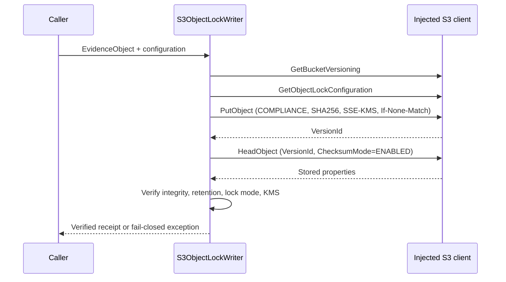

# G2 Reference Adapter — S3 Object Lock Evidence Writer

**Status:** REFERENCE IMPLEMENTATION / OFFLINE TESTED / NOT CONNECTED TO AWS  
**Scope:** GIEN simulation and engineering validation only

## Purpose

The existing PQC WORM logger stores committed batches in process memory and emits an Object Lock-shaped metadata dictionary. That does not establish a remote S3 write or an independently verified retention receipt. This separate adapter defines the storage boundary without modifying the existing logger or connecting to a live account.

## Security and storage contract

The adapter requires an explicitly injected S3-compatible client and a 12-digit expected bucket-owner account ID. It sends the owner constraint on bucket preflight, object write, and exact-version read-back requests. It does not import boto3, resolve ambient credentials, create a session, select an account/bucket, or make a network request by itself.

Before writing, it verifies that:
- Bucket versioning reports `Enabled`.
- `GetObjectLockConfiguration` reports `ObjectLockEnabled=Enabled`.
- A canonical KMS key ARN and positive retention period were supplied by the caller.

For each object, it supplies:
- `ObjectLockMode=COMPLIANCE` and a UTC `ObjectLockRetainUntilDate`.
- `ChecksumAlgorithm=SHA256` and the payload's base64 SHA-256 checksum.
- `IfNoneMatch=*` to avoid accidentally overwriting an existing current key.
- `ServerSideEncryption=aws:kms` with the explicitly configured KMS key ARN.
- An evidence ID and SHA-256/SHA-384 values in object metadata.

A successful receipt requires a version ID and a `HeadObject` read-after-write verification with checksum mode enabled. The writer checks version ID, content length, checksum, COMPLIANCE mode, retention date, KMS encryption/key identity, and evidence metadata.

Failures after a PUT attempt carry a structured stage, bucket, object key, and (when known) version ID.

A PUT transport error reports `PUT_UNKNOWN`; a malformed PUT result reports `PUT_RESPONSE_UNKNOWN`; a failed read-back reports `READ_AFTER_WRITE`; a property mismatch reports `OBJECT_VERIFICATION`; and clock failure after successful read-back reports `RECEIPT_FINALIZATION`.

The post-PUT verification and finalization stages include the version ID returned by S3. An operator can use it to reconcile an already-created object rather than blindly retrying the same key. Failures before any PUT leave the remote-object fields unset.

It rejects unsafe key shapes, non-ASCII or header-invalid metadata, case-insensitive metadata collisions, and user metadata over 2 KiB. The returned `verified_at` timestamp is captured after the read-back checks complete. Missing or mismatched evidence raises `ObjectLockWriteError`; it is not converted to a success receipt.

The 2 KiB limit is based on the UTF-8 byte length of the user metadata keys and values. The adapter applies a stricter US-ASCII character constraint to those fields so they remain valid in the HTTP metadata header path.

## State sequence

## Offline tests

`tests/test_s3_object_lock_writer.py` uses an in-memory fake client. It covers a successful write, versioning disabled, Object Lock disabled, missing version ID, checksum mismatch, altered lock mode/retention, wrong encryption/KMS key, naive clock, malformed key, reserved metadata, and read-after-write failure.

No test uses an AWS session, real credentials, network calls, or an actual bucket.

## Production integration prerequisites

Before connecting this interface to a real account, the system owner must approve and supply:
1. Expected AWS account ID and region, a general-purpose bucket, bucket Object Lock status, versioning state, replication requirements, and approved retention policy.
2. A customer-managed KMS key ARN, key policy, role trust policy, least-privilege identity policy, rotation, and break-glass arrangements.
3. Evidence classification, data minimization, retention schedule, legal-hold workflow, deletion/subject-rights handling, and cross-region residency decisions.
4. Independent controls testing, service monitoring, retry/idempotency design, incident response, and disaster recovery.
5. Actual remote receipts, object versions, lock-mode/retain-until checks, and a separately verified audit trail.

### Minimum IAM and KMS permissions to evaluate

The deployment role must be scoped to the named bucket and key. For this exact preflight/write/read-back sequence, evaluate these permissions against the live API behavior and account policy:

- Bucket preflight: `s3:GetBucketVersioning` and `s3:GetBucketObjectLockConfiguration`.
- Object write: `s3:PutObject` and `s3:PutObjectRetention`.
- Exact-version metadata/checksum read-back: `s3:GetObjectVersion` and `s3:GetObjectRetention`.
- KMS encryption and checksum retrieval: `kms:GenerateDataKey` and `kms:Decrypt` in the IAM identity policy and the KMS key policy.

The Object Lock retention fields returned by `HeadObject` require `s3:GetObjectRetention`; the bucket Object Lock configuration requires `s3:GetBucketObjectLockConfiguration`. KMS checksum read-back also requires appropriate KMS permissions. Do not grant broader bucket, account, or KMS permissions merely to make the adapter pass.

`IfNoneMatch=*` only prevents a write while a current object version exists for that key in a versioned bucket; it is not a permanent global uniqueness guarantee across every historical version. The production caller must define key uniqueness, conflict handling, and audit behavior.

A fake-client test proves only that the adapter calls the declared interface and validates the returned shape. It does not prove AWS availability, authorization, bucket configuration, WORM retention, cryptographic custody, or regulatory compliance.

## AWS API references

- [PutObject](https://docs.aws.amazon.com/AmazonS3/latest/API/API_PutObject.html)
- [GetObjectLockConfiguration](https://docs.aws.amazon.com/AmazonS3/latest/API/API_GetObjectLockConfiguration.html)
- [HeadObject](https://docs.aws.amazon.com/AmazonS3/latest/API/API_HeadObject.html)
- [GetBucketVersioning](https://docs.aws.amazon.com/AmazonS3/latest/API/API_GetBucketVersioning.html)
