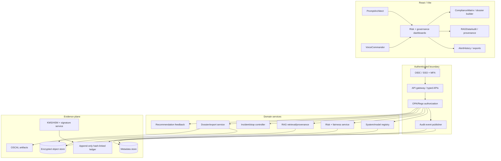

<title>Navigating the Landscape of AI Safety and Global Governance</title>

<abstract>
Implementation blueprint for the fictional GIEN Phase VI-δ and Omni-Sentinel AI governance supervisory application. It defines trust boundaries, React modules, risk telemetry evidence semantics, RAG provenance, emergency-stop behavior, privacy, APIs, OPA/Rego and OSCAL integration, cross-jurisdictional mapping, assurance packages and delivery gates. Project-defined GIEN indices/treaties are not public standards or evidence of compliance.
</abstract>

<content>

# Executive summary

Build the product as an **evidence-management and supervisory decision-support system**, not as a source of regulatory approval. Each finding must answer: what system is in scope, which control applies, what evidence supports the result, who reviewed it, what remains unresolved, and what action is authorized.

Baseline: React + TypeScript + Vite + Tailwind CSS + React Router + Lucide React. Use Recharts for common KPI/time-series charts; D3.js for fairness heatmaps, relationship graphs, vertical timelines and complex matrices; react-diff-viewer for version comparison; jsPDF for dossier rendering; Fuse.js for authorized client-side search; Web Speech API for optional voice control; and OPA/Rego at the trusted policy-enforcement boundary.

**Evidence rule:** every metric, fairness result, attestation, ZK proof, stress-test result and transmission record carries a source status: live, synthetic, replay, external-attested or evidence-pending. Synthetic values must display “DEMONSTRATION DATA”. UI status, self-generated hashes, passing schema tests or a valid PDF do not establish regulatory approval, independent assurance or production safety.

## 1. System architecture

Trust boundaries:
1. **Browser:** treat form values, URL parameters, speech transcripts, local state and retrieved text as untrusted. Never place signing keys, service credentials or policy bypasses in frontend code.
2. **API:** authenticate every request; enforce object-level and tenant authorization server-side. Hiding a route is not authorization.
3. **Policy plane:** version OPA bundles; deny on policy errors; log decision and policy version; test positive, negative, missing and malformed inputs.
4. **Evidence plane:** restrict writers, encrypt data, use append-only/retention-locked storage where required, rotate keys, and independently verify evidence. Hashes establish byte consistency, not source-data truth.
5. **Model boundary:** retrieval results, tools, transcripts and model outputs are untrusted. Enforce provenance, prompt-injection controls, least privilege, output schemas and human review before consequential actions.

## 2. Frontend modules and UX

Recommended source areas: app/routes/providers; reusable charts and evidence components; feature modules for prompt-architect, voice-commander, risk-indices, compliance-matrix, rag-data-audit, alert-history, governance-stacks, digital-twin, constitutional, submission-packages, workflow-recommendations and executive-summary; plus hooks, typed services, schemas and tests.

| Component | Implementation requirements | Boundary |
|---|---|---|
| PromptArchitect | Draft, validate, version, compare and stage prompts | Edited prompts never activate in production without review and release approval |
| VoiceCommander | Small allowlisted commands, visible transcript and confirmation | Recognition is not authentication; uncertain commands fail closed |
| FairnessHeatmap / ParityDashboard | Group metrics, denominators, sample sizes, confidence intervals, missing-data cues | Show chosen metric and limitations; parity metrics may conflict |
| ComplianceRegulatory | D3 framework/control/evidence graph and timelines | Applicability, mapping confidence and assessment result are distinct fields |
| RAGGovernanceDashboard | Heatmaps for source coverage, access, freshness, retrieval quality and grounding | Show source lineage, access decisions, citation coverage and injection-test status |
| RAGDataAudit | Source-to-output lineage, versions and authorized previews | Per-object authorization and redaction |
| AlertHistory | Filter, assign, acknowledge, resolve; CSV/JSON export | Immutable event ID and actor history; audit every export |
| ComplianceMatrix | Obligation/control/evidence/owner/test/finding/remediation | “Not assessed” must never imply “compliant” |
| HumanMeaningConstitution | Internal ethical constraints, violations, waivers and human decisions | Label GIEN rules as project-defined rather than public law |
| SDTStressDrills | Reproducible Panels 13-15 scenario replay | Distinguish replay/synthetic evidence from live telemetry |
| TemplateLibrary.tsx | Search/select versioned templates | Sanitize output; never render untrusted HTML |
| ExecutiveSummary | Trends, material findings, decisions needed, evidence gaps | Freshness and uncertainty must be visible without opening tooltips |

Use Recharts for normal time-series, latency, counts and KPIs; use D3 for custom heatmaps, timelines, flow diagrams and control dependency graphs. Each chart needs a table alternative, labels, units, timezone, denominator, keyboard support and meaning beyond colour. Use Fuse.js only against metadata the user is already permitted to see. React Context is suitable for session metadata, theme and toasts, not high-frequency telemetry state. Toasts are transient notifications, not the audit log. Theme mode must preserve contrast and focus visibility.

## 3. Risk telemetry evidence contract

Every observation should include:
- metric ID/value/unit and versioned definition;
- source status and source/evidence reference;
- method/model version, confidence or uncertainty;
- exact UTC window, observation time and freshness/expiry;
- threshold, threshold owner and approval state;
- aggregation scope, limitations and validation status.

Project indices include S_sys, G-SRI, C-SRI, CGR-I, CCR-I, G-SRI-VII, A-SRI, P-SRI, p(doom), p(doom)_kernel, Δ_drift and Δ_OSCAL. Project-proposed thresholds are S_sys < 0.35; G-SRI < 0.40; C-SRI < 0.30; CGR-I < 0.25; CCR-I < 0.20; G-SRI-VII < 0.50; A-SRI < 0.45; P-SRI < 0.15; p(doom) < 0.001; p(doom)_kernel < 0.0001; Δ_drift < 0.05; Δ_OSCAL < 0.02. These are not external regulatory limits and must be approved and validated before operational use. p(doom) and p(doom)_kernel are not recognized regulatory metrics; label them experimental until event definition, calibration, limitations and validation are independently established.

The daily dossier should end at 09:00 UTC and cover the preceding 24 hours. Persist the exact query window. Late evidence creates a new dossier version rather than silently rewriting an earlier one. A missing source means evidence-pending—not an invented value and not “low risk”. Distinguish threshold breach, stale data, missing data, invalid data and low confidence.

## 4. API boundaries and RAG data flow

Suggested versioned endpoints:
- GET /api/v1/systems — tenant/role-scoped inventory.
- GET /api/v1/telemetry/metrics?from=&to= — metrics with UTC validation, pagination and source status.
- GET /api/v1/evidence/{id} — authorized, redacted evidence.
- POST /api/v1/prompts/drafts — create a draft, never activate production implicitly.
- POST /api/v1/evaluations — run an approved staged evaluation with model/prompt version and audit ID.
- POST /api/v1/alerts/{id}/acknowledgements — idempotent, actor-attributed acknowledgement.
- POST /api/v1/interventions/stop — scoped, authenticated server-side stop request.
- POST /api/v1/feedback — purpose-limited, schema-validated recommendation feedback.
- POST /api/v1/dossiers — freeze and generate a versioned evidence snapshot.

Use correlation IDs end-to-end, stable safe error codes and idempotency keys for mutations. Never return prompts, stack traces, policy internals, credentials or sensitive data in errors.

RAG flow: authorize user → retrieve only permitted sources → preserve source/document/chunk/version/hash metadata → inspect freshness and conflicts → treat retrieved content as data, not instructions → build a versioned prompt → apply input/tool/output policies → validate output schema → require human review for high-impact outputs → store lineage and reviewer action → render citations and unsupported claims. Similarity score is not proof of factual correctness.

## 5. Voice commands, alerts and emergency stop

Voice is an accessibility/convenience feature, not an authorization boundary. Allowlist commands such as “open risk dashboard”, “filter critical alerts”, “read selected finding” and “prepare draft report”. Do not use free-form speech to authorize deletion, a regulator transmission, policy changes or production stop operations.

For consequential commands, show the recognized transcript and target; require explicit confirmation and, when warranted, fresh authentication or dual control. Denied microphone permission, unsupported browsers, uncertain transcription and network errors must fail closed. Provide touch/keyboard alternatives and an active microphone indicator.

A React button cannot itself stop an inference workload. The backend controller must authenticate/authorize and scope the request, persist it before acknowledging, use an idempotency key, signal the runtime, verify the runtime acknowledgement, and report requested/in-progress/verified-stopped/partially-stopped/failed with timestamps and evidence. Never render STOPPED based only on the button click. Test an independent response channel for UI or network outage.

## 6. RAGDataAudit, exports and cryptographic integrity

Record lineage from source system/document version → ingestion → chunk IDs → embedding model/version → retrieval event → prompt version → response ID → citations → policy decisions → human review → downstream action. Minimize retained raw content and use redacted previews.

CSV/JSON exports require schema version, export time, filters, timezone, record count, source status and manifest digest. Escape formula-leading CSV cells, schema-validate JSON, authorize each row, apply redaction and audit the export. Corrections should be appended as new events. Exports are data-exfiltration surfaces.

NIST FIPS 203 specifies a key-encapsulation mechanism—not signatures. FIPS 204 specifies ML-DSA signatures and FIPS 205 specifies SLH-DSA signatures. Use maintained crypto libraries and KMS/HSM-backed keys, canonical serialization, explicit algorithms/key IDs, signed manifests, rotation records and restore tests. Merkle roots show consistency relative to committed leaves and publisher/key trust; they do not establish completeness, lawful basis or truth of sources. WORM storage, hash-linked ledgers and PQC signatures serve different properties.

TEE/RTEE/vTPM evidence must be verified server-side and include freshness nonce, verifier, device reference, PCR/event log, expected/observed measurements, policy version, result, expiry and key provenance. Client-reported PCR_MATCH=TRUE is not attestation. ZK proof records must identify circuit/program hash, proving/verifying key, proof-system version, public inputs and verifier result. Proof validity does not prove the circuit specification, inputs or real-world model behavior are sound.

## 7. CCaaS call summarization and privacy

Workflow: notice/disclosure and applicable consent handling → transcription → minimization/redaction → summarization → factuality/policy checks → human review where needed → authorized CRM write-back → retention/deletion workflow.

Before production, document purposes, lawful basis, controller/processor roles, subprocessors, data categories, recipients, transfers, retention, rights handling, security and whether a DPIA is required. Call-recording and transcription rules vary by jurisdiction/channel. Do not assume participation alone constitutes consent for every purpose. Assess special-category data, employee monitoring, automated decision-making and financial recordkeeping separately.

Minimize raw audio/transcript retention; do not train on customer calls by default; encrypt and scope decryption; avoid sensitive payloads in logs; test hallucination, omission, speaker attribution, language/accent performance and incorrect commitments; cite transcript spans for material assertions; retain uncertainty for human review; and enforce rights/retention workflows. Pseudonymized data can remain personal data. Differential privacy may suit aggregate analytics with an explicit privacy budget and utility evaluation; it is not a blanket privacy guarantee for individual summaries. A TEE does not replace lawful basis, transparency, minimization or vendor governance.

## 8. OPA/Rego, OSCAL and assurance claims

Use OPA for machine-evaluable gates: required evidence and freshness, role permissions, prompt approval, security findings, threshold-based review and release readiness. Deny on policy evaluation error and test positive/negative cases including null fields, stale attestations, unknown policy versions, wrong roles and frontend-state overrides. A passing policy test is not proof of compliance with an entire law.

Use OSCAL v1.1.2 models only where the exported artefact conforms to the corresponding schema. Pin versions and validate references, component/control IDs, results and remediation links. Maintain source framework/version, jurisdiction, applicability decision and rationale, control mapping, evidence reference, assessor, test procedure, outcome, exception, owner and remediation date. Do not label generic JSON “OSCAL”.

AAP-1, CFE-1.0, Protocol SGR-028 and GIEN constitutional constructs are project-defined. For each AAP-1 claim, retain ID/text, system/deployment scope, time period, evidence IDs, method/version, reviewer, assumptions, exclusions, uncertainty, status, expiry and revocation path. Use states draft, evidence-pending, reviewed, rejected and expired. Reserve independently-assured for a separately evidenced independent assessment.

Submission packages should include: tagged report XML; manifest with paths, media types, source statuses, digests, timestamps and schema/tool versions; conformant OSCAL artefacts where required; claim-to-evidence index; exceptions/remediation; validation results; human sign-off; and limitations/unavailable evidence. Required wrapper:

    <title>GIEN Supervisory Technical Dossier — [system / reporting window]</title>
    <abstract>Scope, window, evidence status, material risks, limits and approvals.</abstract>
    <content>Inventory, applicability, controls, tests, lineage, incidents, exceptions, remediation and sign-offs.</content>

## 9. Cross-jurisdictional mapping

Keep a versioned framework registry instead of hard-coded JSX. Each row needs exact title/version/source URL, jurisdiction, trigger, applicability state, legal/control reference, internal control, rationale, evidence, reviewer and review dates. Use applicable, not-applicable-with-reason, pending-legal-review and informational; never collapse them into one green/red status.

| Framework | Applicability check | Associated evidence (not proof of compliance) |
|---|---|---|
| EU AI Act (2024/1689 as amended) | Market, provider/deployer role, AI class, effective date | Classification, risk management, tech documentation, logging, transparency, oversight |
| NIST AI RMF 1.0 / AI 600-1 | Voluntary baseline and GenAI-specific risk mapping | Govern/Map/Measure/Manage trace, TEVV, red-team and residual risk |
| ISO/IEC 42001:2023 | AIMS scope and assurance objective | Policy, roles, risk treatment, operation, internal audit, management review |
| Basel III/IV; Federal Reserve SR 11-7 | Relevant institution and model/prudential scope | Model inventory, validation, outcomes analysis, independent challenge |
| SR 26-2 | Verify exact title, issuer and current official source first | Source-controlled obligation and legal applicability decision; do not infer from identifier alone |
| DORA / NIS2 | Covered financial/essential entity and local rules | ICT risk, incidents, resilience, supply chain, third-party evidence |
| GDPR | Territorial/material scope for personal-data processing | Basis, minimization, rights, processor terms, DPIA where required, security, retention |
| FCRA/ECOA/Regulation B | Covered U.S. consumer-reporting or credit decision | Permitted purpose, adverse-action reason, lineage, fair-lending tests |
| MAS FEAT / HKMA FEAT and Fintech 2030 AI² | Relevant institution and current official guidance | Fairness, ethics, accountability, transparency, validation, model risk |
| FCA SMCR / Consumer Duty | FCA-regulated firm and applicable customer/managerial duties | Accountable owners, outcomes, complaints, remediation |
| SEC Rule 17a-4 | Covered broker-dealer records and applicable storage method | Record classification, preservation, retrieval, audit-trail and retention tests |
| ICGC/GASO | Verify whether a public source, private framework or project term | Source registry, legal status and reviewed rationale |
| Interstellar Accord / Galactic Treaty Framework | Fictional GIEN scenario unless a valid instrument is established | Explicit fictional label; separate from public-law obligations |
| CFE-1.0 / Protocol SGR-028 | Fictional project protocol | Versioned invariants, TLA+ spec, assumptions and model-check evidence |

EU AI Act dates must be maintained from the consolidated Regulation and current Commission guidance. Current Commission guidance states general application/enforcement from 2 August 2026, with certain high-risk rules later, including 2 December 2027 and 2 August 2028 following 2026 simplification changes. Revalidate dates each release. Applicability and legal mapping require responsible counsel/compliance review.

## 10. ISO/IEC 42001 and NIST AI RMF control linkage

This is an indicative design crosswalk, not a complete or accredited interpretation. ISO/IEC 42001 Annex A controls are selected and justified through the organization's risk-treatment process and Statement of Applicability. NIST AI RMF functions are Govern, Map, Measure and Manage. Pin licensed/current source versions before asserting formal alignment.

| Control plane | ISO/IEC 42001 relationship (indicative) | NIST function | Evidence |
|---|---|---|---|
| Roles/policy/approvals | Leadership, planning, support, operation and applicable organizational controls | Govern | Policy, RACI, approvals, training, accepted risk |
| Inventory/purpose/impact | Risk and impact assessment/treatment | Map | System card, affected parties, intended use, data map |
| Fairness/robustness/security | Operational control and improvement | Measure | Protocol, datasets, subgroup uncertainty, red team |
| Prompt/RAG release | Lifecycle, supplier and change controls | Map/Measure/Manage | Provenance, injection tests, versioned approvals, rollback |
| Incident/intervention | Nonconformity, corrective action, monitoring | Manage/Govern | Timeline, authority, containment and root cause |
| Monitoring/review | Performance evaluation, audit, continual improvement | Govern/Measure/Manage | Freshness, drift, complaints, audit actions |
| Supplier/CCaaS | Applicable supplier and contractual controls | Govern/Map/Manage | Processor terms, subprocessors, transfers, exit plan |
| Submission evidence | Document control and traceability | Govern/Manage | Dossier, manifest, validations, exceptions, sign-off |

## 11. Security, observability and latency

Minimum controls: OIDC/SSO; MFA for privileged actions; short-lived sessions; least privilege plus server-side object authorization; CSP/output encoding; CSRF protection where appropriate; rate limiting; dependency pinning; secret scanning; SBOM and image scans; encrypted transport/storage; KMS/HSM-managed keys; separate demo/staging/prod stores; and redacted structured logs. VITE_-prefixed variables are browser-visible and must not contain secrets.

Monitor p50/p95/p99 latency, error rates, telemetry age/source health, policy-deny rate, provenance/citation coverage, fairness test completion, export validation, attestation freshness and stop acknowledgement. Initial **targets to validate by load test**, not measured claims: cached telemetry p95 ≤ 500 ms; standard dashboard query p95 ≤ 1.5 s; simple local Rego decision p95 ≤ 50 ms; ordinary export p95 ≤ 10 s. Voice latency depends on browser/runtime. Absence of telemetry is itself a reviewable alert.

Vite reliability: pin Node/package-manager versions, commit lockfile, use npm ci, keep environment variables non-sensitive when prefixed VITE_, test direct navigation to every React Router route in production preview, and clean up React effects rather than disabling StrictMode to conceal duplicate side effects.

## 12. Workflow recommendations and model retraining

Start as a human-reviewed recommender. Each recommendation needs reason, expected outcome, effort band, uncertainty, source/runbook, version and expiry. Feedback stores recommendation/version, accepted/rejected/deferred, standardized reason, minimized comment, role, outcome and timestamp. Feedback can be biased, selective or poisoned. Do not train production directly from feedback. Use quarantine → privacy/security screening → deduplication and label-quality checks → bias/poisoning tests → offline evaluation → independent review → shadow/canary → signed model version → monitored rollout and rollback.

## 13. Digital Twin, constitutional invariants and emergency-stop assurance

Panels 13-15 need versioned scenarios, initial conditions, data status, model/tool versions, random seed, intervention, expected assertion, tolerance and replay artifact. A replay does not prove identical real-world behavior. For CFE-1.0/SGR-028, preserve TLA+ spec, assumptions, model bounds, tool version, command and result. A finite model check covers only the stated model/configuration.

Emergency-stop invariant: authorized and scoped request; persistence before acceptance; idempotency; verified stop or explicit partial/failure status; and an audit event even if the dashboard is unavailable. Drill network partition, delayed acknowledgement, stale credentials, compromised client and unavailable dependencies. Keep automated tests, model checking, production monitoring, cryptographic verification and independent assurance as different evidence types.

## 14. Governance RACI

| Activity | Accountable | Responsible | Consulted |
|---|---|---|---|
| System inventory and risk acceptance | Executive risk owner | Product/model owner | Legal, privacy, security |
| Legal applicability | Compliance/legal lead | Mapping owner | Privacy and sector specialists |
| Prompt/RAG/model evaluation | Model risk owner | AI engineering | Security, privacy, independent reviewer |
| Access policy/emergency stop | Technology/operational-risk owner | SRE/security | Incident commander, legal |
| Evidence and dossier integrity | Evidence governance owner | Platform engineering | Security, records manager, reviewer |
| CCaaS retention/processing | Controller accountable owner | Contact-centre owner | DPO/privacy, vendor, legal |
| Recommendation retraining | Model governance owner | ML platform/data steward | Fairness, security, privacy, business |

Record actual actor and decision, not just the displayed role. Where roles overlap, preserve applicable independence requirements.

## 15. Release gates and roadmap

CI gates: TypeScript strict build/lint/tests; route smoke and accessibility; deterministic metric/threshold/freshness/UTC tests; prompt injection, RAG access, citation and output-schema tests; positive/negative Rego tests; pinned OSCAL/JSON Schema validation; export authorization/redaction/CSV formula-injection tests; VoiceCommander denial/ambiguity tests; emergency-stop persistence/idempotency/timeout drills; privacy deletion/retention tests; dependency/SBOM/CodeQL/secret/container scans; and evidence-manifest integrity.

**Phase 0:** map current routes/dependencies/sources, label fixtures, define metrics, fix workflow YAML and add evidence schemas.  
**Phase 1:** secure application shell, OIDC, typed APIs, accessible dashboard and AlertHistory.  
**Phase 2:** RAG lineage, applicability data model, OSCAL/OPA checks and versioned dossiers.  
**Phase 3:** metric method registry, freshness/uncertainty, Digital Twin replay and backend stop controller in non-production.  
**Phase 4:** CCaaS privacy/legal review, redaction/retention/rights and offline workflow-recommendation evaluation.  
**Phase 5:** threat model, penetration test, independent control review, resilience drills, restore/key-rotation tests and management review.

A workflow state of startup_failure with no jobs/logs must be distinguished from a test failure; it indicates a workflow-startup/infrastructure outcome pending separate diagnosis.

## 16. Authoritative references

- NIST AI RMF resources, AI RMF 1.0 and NIST AI 600-1: https://www.nist.gov/itl/ai-risk-management-framework/ai-risk-management-framework-resources. NIST indicates AI RMF 1.0 is being revised; pin the baseline used.
- ISO/IEC 42001:2023 overview: https://www.iso.org/standard/81230.html. Use current licensed text for exact clause/Annex A mappings.
- EU AI Act consolidated text: https://eur-lex.europa.eu/eli/reg/2024/1689; Commission timeline: https://digital-strategy.ec.europa.eu/en/policies/regulatory-framework-ai.
- GDPR: https://eur-lex.europa.eu/eli/reg/2016/679/oj.
- OSCAL v1.1.2: https://pages.nist.gov/OSCAL-Reference/models/v1.1.2/.
- NIST FIPS 203/204/205: https://csrc.nist.gov/News/2024/postquantum-cryptography-fips-approved.
- OPA/Rego: https://www.openpolicyagent.org/docs/policy-language.
- DORA: https://eur-lex.europa.eu/eli/reg/2022/2554/oj.
- NIS2: https://eur-lex.europa.eu/eli/dir/2022/2555/oj.
- Link current official sources for SR 11-7, SR 26-2, SEC Rule 17a-4, FCRA/ECOA, FCA, MAS and HKMA before production applicability or legal compliance claims.

</content>
