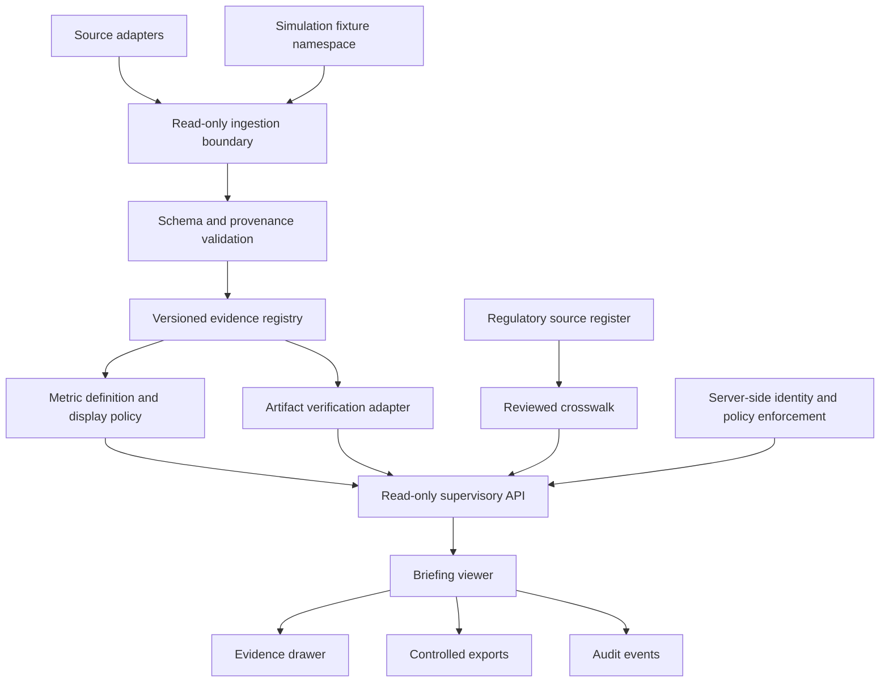

# WP-101 — Canonical Supervisory Briefing Viewer and Evidence Drawer

**Document status:** Draft implementation brief  
**Work package:** WP-101  
**Baseline:** `main` at `bf16e0c1a6898db392935462ec8257976e0cd8ed`  
**Depends on:** WP-098 evidence contract and metric catalogue review; no runtime dependency is introduced by this design-only change  
**Target application:** `gien-supervisory-brief/` (React 18, TypeScript, Vite, React Router HashRouter)  
**Product mode:** Read-only, simulation-labelled prototype until real source integrations and authorisations are independently established

> **Fictional project notice.** GIEN, Omni-Sentinel, the treaty instruments, the project indices and dossier telemetry are fictional research/simulation constructs. A UI, schema, digest, successful CI job or synthetic test does not establish production operation, legal compliance, regulatory approval or independent assurance.

## 1. Decision and objective

WP-101 specifies a canonical supervisory briefing experience that lets an authorised reviewer answer five questions about every displayed assertion:

1. What exactly is being asserted?
2. Where did the observation or document originate?
3. Which definition, version, transformation and time window produced the displayed value?
4. Which verification checks were performed, by which verifier and policy?
5. What remains unverified, provisional, stale, unresolved or outside the user's authority?

The implementation should extend the existing `gien-supervisory-brief` application. It must not introduce a competing dashboard, change the existing 20-item sidebar count, or treat a role selector in the browser as a security boundary.

**Primary outcome:** every displayed metric and supervisory claim has an inspectable evidence path and a separate representation of evidence origin, verification, methodology maturity, freshness and applicability.

## 2. Current repository context and constraints

The baseline repository already contains:

- React 18 and TypeScript with Vite;
- `HashRouter` and URL-persisted role/disclosure parameters;
- a 20-item sidebar in `src/components/Layout.tsx`;
- the risk-index page in `src/pages/RiskIndices.tsx`;
- an existing generic detail drawer in `src/components/DetailDrawer.tsx`;
- simulated risk fixtures in `src/data/gienData.ts`.

The existing application contains hard-coded numeric readings and operational-looking status labels. These are fictional UI fixtures, not measured institutional telemetry. WP-101 must make this boundary visible at the point of use and in every export.

WP-098 PR #248 is the intended source for the hardened Phase 1 evidence contract and metric catalogue, but that PR must be reviewed and merged before the viewer treats its contracts as the accepted interface. Until then, WP-101 uses the contract description as a dependency, not as an already ratified API.

## 3. Scope

### In scope

- Dossier list and read-only dossier detail.
- Schema-driven metric tiles and a reusable evidence drawer integrated into the existing Risk Indices page.
- Provenance chain, evidence/artifact references, digest metadata and verification result.
- Separate evidence-origin, verification, methodology, freshness, applicability and approval dimensions.
- Role- and disclosure-aware presentation, with server-side authorisation required for protected data.
- Source-register and reviewed-crosswalk references.
- Accessible keyboard, focus and screen-reader behaviour.
- Deterministic exports containing the same state and limitations as the UI.
- Synthetic test fixtures visibly segregated from any future observed-data adapter.

### Explicitly out of scope for the first release

- Automated regulatory determinations, compliance certification or autonomous supervisory action.
- A production probability estimate for `p(doom)` or `p(doom)_kernel`.
- Custom cryptographic algorithms, custom attestation verifiers or bespoke zero-knowledge circuits.
- Live ingestion from financial institutions, supervisory authorities, customer datasets or hardware roots of trust.
- Write access to source systems, control assessments, dossiers or policy registries.
- A claim that a GREEN display is equivalent to legal compliance or control effectiveness.

## 4. Canonical evidence and display semantics

### 4.1 Independent status dimensions

Do not collapse the following dimensions into one colour or a single `status` field.

| Dimension | Allowed initial values | Interpretation |
|---|---|---|
| Evidence origin | `OBSERVED`, `SIMULATED`, `UNKNOWN` | Whether the value came from an identified real observation, a synthetic fixture or an unknown source |
| Verification | `VERIFIED`, `FAILED`, `PARTIAL`, `NOT_CHECKED`, `NOT_APPLICABLE` | Outcome of explicitly named verification checks |
| Methodology | `VALIDATED`, `PROVISIONAL`, `UNVALIDATED`, `UNRESOLVED` | Maturity of the metric or assessment method |
| Freshness | `CURRENT`, `STALE`, `UNKNOWN` | Whether evidence meets a declared freshness policy |
| Applicability | `APPLICABLE`, `NOT_APPLICABLE`, `UNDETERMINED` | Applicability of a legal, supervisory or technical requirement |
| Approval | `APPROVED`, `PENDING`, `REJECTED`, `NOT_REQUIRED` | Decision by an identified authorised reviewer |

The UI may use neutral status chips but must not infer one dimension from another. For example, a valid digest can coexist with an unvalidated metric method; a current observation can coexist with an undetermined legal applicability decision.

### 4.2 Metric display policy

The accepted metric catalogue must be the single source of truth. The UI must not carry a second, independently editable list of metric definitions or thresholds.

| Metric class | Display policy |
|---|---|
| Provisional scalar metrics such as `S_sys`, `G-SRI`, `C-SRI`, `A-SRI`, `P-SRI` and `Δ_drift` | A scalar may appear only as a labelled simulation/provisional value. Do not infer GREEN/AMBER/RED until an approved formula, threshold policy and validation record exist. |
| `CGR-I`, `CCR-I`, `G-SRI-VII` | The current catalogue marks these unresolved. Do not show scalar values, thresholds, sparklines or risk bands. Display the unresolved definition and the approval evidence required to resolve it. |
| `p(doom)`, `p(doom)_kernel` | Research/simulation-only. Never present as a validated forecast, operational probability, or risk band. Require event definition, population, horizon, estimator/model version, calibration, validation report and uncertainty interval before any future evaluated estimate. |
| `Δ_OSCAL` | Structured change set only: added, removed and modified control IDs plus catalogue versions and diff-tool version. No scalar gauge or GREEN band. |
| Missing, stale or unassessed values | Use `null` and an explicit state. Never convert missingness to zero, nominal, safe or GREEN. |

This rule directly addresses the observed mismatch between the WP-098 catalogue's unresolved states and later fictional dossier material that prints numeric values for those constructs. Dossier fixtures and viewer policy must consume the same catalogue version.

### 4.3 Evidence path

Every observation must trace through:

`metric definition + version → observation status + window → source observation IDs → transformation lineage → applicable controls → artifact references → algorithm-labelled digests → verification policy + result → reviewer decision`

A digest proves byte consistency against the digest supplied. It does not prove that an originating source was truthful, that the collection was complete, or that a control was effective. A signature supports integrity and attribution only subject to identity, key custody, trust roots and verification policy.

## 5. Target architecture

### 5.1 Frontend integration

Use the existing `gien-supervisory-brief` app. Proposed implementation boundaries:

- `src/types/evidence.ts`: explicit TypeScript interfaces corresponding to the accepted JSON Schema.
- `src/data/metricDisplayPolicy.ts`: a thin typed adapter over the versioned catalogue; no duplicate formulas or thresholds.
- `src/components/EvidenceDrawer.tsx`: reusable read-only evidence panel, preferably composed with the existing `DetailDrawer`.
- `src/components/EvidenceStatus.tsx`: accessible status rendering for each independent status dimension.
- `src/services/evidenceClient.ts`: typed, read-only API client; fixture provider remains separately selectable and explicitly labelled.
- `src/pages/RiskIndices.tsx`: replace unsupported rating presentation with catalogue-driven presentation and open the evidence drawer from the selected metric.
- `src/data/fixtures/`: synthetic fixture records only; fixture records must contain `evidence_origin: SIMULATED`.

Do not add a navigation page merely to host the drawer. Preserve the existing 20-page sidebar unless a separately reviewed product decision changes it.

### 5.2 Backend API boundary

Initial interface is read-only:

| Endpoint | Purpose |
|---|---|
| `GET /api/v1/dossiers/{dossierId}` | Dossier metadata, window, source status and contract version |
| `GET /api/v1/metrics/{metricId}/observations` | Observations with metric-definition version and methodology status |
| `GET /api/v1/observations/{observationId}/evidence` | Source, collection and transformation provenance |
| `GET /api/v1/artifacts/{artifactId}/verification` | Digest/signature verification metadata and result |
| `GET /api/v1/controls/{controlId}/mappings` | Reviewed crosswalk mappings and source references |
| `GET /api/v1/audit-events` | Authorised audit history |

Every response should expose an API version, schema/contract version, retrieval timestamp and correlation ID. Use explicit pagination and a stable as-of timestamp. Enforce tenant, organisation, dossier and record-level authorisation on the server. A frontend role selector controls presentation only; it is not authorisation.

### 5.3 Evidence object minimum fields

An observation envelope should identify:

- observation ID and dossier/window ID;
- metric ID, metric-definition ID and exact version;
- evidence origin and methodology status;
- value and unit, or null with a declared missingness state;
- event/measurement time and ingestion time;
- source-system identifier and collector identity/version;
- transformation lineage and source observation IDs;
- artifact references with digest algorithm and digest value;
- verifier identity/version, verification policy version, outcome and verification time;
- freshness policy and result;
- reviewer/approval reference where applicable.

Never store credentials, private signing keys or raw authentication tokens in an evidence object.

## 6. Security, privacy and threat model

| Threat | Expected control | Required verification |
|---|---|---|
| Cross-tenant data disclosure | Server-side tenant/resource authorisation; default deny | Negative API tests for every resource type |
| Browser role escalation | Treat role/layer as presentation context only | Direct API calls cannot bypass server policy |
| Simulation presented as observation | Origin tag enforced by schema and UI; persistent labels in export | Fixture-origin rendering and export tests |
| Stale or replayed evidence | Explicit event/ingestion times, nonce or version context where relevant, freshness policy | Stale and replay fixture tests |
| Digest substitution | Algorithm-labelled digest; verifier checks expected artifact identity | Tampered artifact negative test |
| Signature overclaim | Verification records key identity, trust policy, time and outcome | Unknown/revoked key and invalid-signature tests |
| Source-data poisoning | Provenance and collector trust boundary; do not equate hash with truth | Source integrity and lineage review |
| Cross-site scripting / untrusted content | Render source strings as text; sanitise any permitted rich text | XSS regression cases |
| Over-retention or excessive personal data | Data minimisation, purpose limitation, retention/deletion design | Privacy review and retention tests |
| Export leakage | Re-authorise export server-side and watermark simulated material | Role/tenant export tests |

The first release should use synthetic or irreversibly sanitised fixtures. Any later use of personal data requires a processing-purpose assessment, data-minimisation review, security controls and a DPIA screening decision where GDPR Article 35 conditions may apply.

## 7. Accessibility and usability

Target WCAG 2.2 AA for the viewer:

- all actions work using keyboard only;
- drawer opens with a meaningful accessible name and moves focus appropriately;
- closing returns focus to the invoking metric;
- visible focus indication and logical tab order;
- semantic headings, tables and form labels;
- state is conveyed by text and icon/shape, never colour alone;
- charts have equivalent textual/table representations;
- screen readers announce state changes without repeated or noisy announcements;
- reduced-motion preferences are respected.

Evaluate five tasks with representative users: locate a dossier, identify a metric's origin, inspect methodology maturity, verify an artifact, and explain why a metric is not rated.

## 8. Test and CI strategy

### Unit and contract tests

- Validate all fixtures against the accepted JSON Schema.
- Validate cross-field invariants for each evidence-origin and missingness state.
- Verify metric rendering rules from the catalogue.
- Verify unresolved metrics never expose scalar values or bands.
- Verify `Δ_OSCAL` is a structured diff.
- Verify `p(doom)` variants remain research/simulation-only.
- Verify digest algorithm and length matching.

### Integration tests

- Dossier → metric → observation → artifact retrieval.
- API rejects unauthorised cross-tenant and out-of-scope requests.
- Viewer and export carry the same contract version and status dimensions.
- Failed verifier result cannot be rendered as VERIFIED.
- Stale evidence does not render CURRENT.

### Browser and accessibility tests

- Evidence drawer open, navigation, close and focus restoration.
- Keyboard-only path.
- Screen-reader labels and headings.
- Narrow viewport and zoom behaviour.
- No console errors or failed requests during primary workflows.

### CI gates

1. JSON Schema and fixture validation.
2. TypeScript strict typecheck.
3. Production Vite build.
4. Unit and integration tests.
5. Lint and dependency/security scans.
6. Accessibility tests.
7. Export consistency and simulated-label checks.

Pin third-party GitHub Actions to immutable commit SHAs. Use least-privilege workflow permissions. Do not add a deployment step to the first WP-101 pull request.

## 9. Proposed acceptance criteria

WP-101 implementation is ready for a controlled non-production pilot only when all of the following are demonstrated:

- Every displayed metric resolves to one versioned definition in the accepted catalogue.
- Unresolved metrics cannot render scalar values, sparklines or risk bands.
- Unvalidated probability indicators cannot be represented as validated forecasts or operational risk ratings.
- Provisional values carry origin and methodology labels, and do not acquire GREEN/AMBER/RED states without an approved threshold policy.
- Unknown, not-estimated and not-assessed values remain null with distinct states.
- `Δ_OSCAL` renders as a structured catalogue diff.
- Every artifact digest includes an algorithm identifier.
- Verification result records verifier and policy versions, verification time and outcome.
- Simulation labels persist across viewer, export, print and API.
- Direct API requests cannot bypass organisation/tenant permissions.
- Keyboard and screen-reader checks pass for the primary drawer flow.
- The exported dossier reproduces the displayed evidence states and contract version.
- Security, privacy and legal review decisions are documented before any non-synthetic data integration.

No acceptance criterion should use the words “compliant”, “approved by regulator”, “production assured” or “independently assured” without the appropriate external evidence.

## 10. Delivery sequence and gates

### M0 — Contract dependency and discrepancy resolution

- Review WP-098 PR #248 and its status checks.
- Resolve the mismatch between unresolved metric definitions and numeric values in later simulation dossier output.
- Freeze the accepted schema/catalogue version and display policy.
- Record metric owners and reviewers.

**Exit:** WP-098 accepted or a separately approved compatible contract is published; no open semantic contradiction remains.

### M1 — Fixture-backed viewer

- Add typed evidence interfaces and policy adapter.
- Add EvidenceDrawer and status components.
- Integrate within Risk Indices.
- Add clear simulation-only labels.
- Add contract, rendering and accessibility tests.

**Exit:** build/tests pass; unresolved and unvalidated metric cases render safely.

### M2 — Read-only API integration

- Implement typed API client.
- Add server-enforced authorisation.
- Add artifact verification adapter.
- Add audit history and export consistency.

**Exit:** negative security tests pass; provenance can be independently reconstructed from authorised test fixtures.

### M3 — Controlled non-production evaluation

- Conduct representative-user evaluation.
- Complete security and privacy review.
- Measure performance under defined data volume and concurrency.
- Publish limitations and remediation report.

**Exit:** formal pilot decision by the accountable platform owner and relevant security/privacy reviewers.

## 11. Planning hypotheses (not measured service levels)

Initial performance targets for evaluation, to be revised after baseline measurement:

| Measure | Proposed hypothesis |
|---|---:|
| Cached dossier list API p95 | ≤ 500 ms |
| Cached dossier detail API p95 | ≤ 500 ms |
| Evidence drawer interaction p95 | ≤ 1 s |
| Initial viewer load p95 | ≤ 2 s |
| Unauthorised cross-tenant reads in test suite | 0 |
| Unresolved metrics shown as operationally rated | 0 |
| Simulation records rendered without simulation label | 0 |

Do not state these as achieved performance.

## 12. Ownership and segregation of duties

| Activity | Accountable | Responsible | Independent challenge |
|---|---|---|---|
| Product scope and pilot decision | Platform owner | Product lead | Supervisory user representative |
| Evidence contract | Governance lead | Data architect | QA/security reviewer |
| Metric methodology | Metric owner | Model/measurement team | Independent validation reviewer |
| Regulatory applicability | Legal/regulatory owner | Regulatory analyst | Compliance reviewer |
| Privacy | Privacy owner | Privacy engineering | Legal/DPO review |
| Security | Security owner | Security engineering | Independent security reviewer |
| Implementation | Engineering lead | Frontend/backend engineers | Code review and QA |
| Release evidence | QA lead | Test engineering | Platform owner |

The author of a metric must not be its sole validator. The author of a regulatory mapping must not be its sole approver.

## 13. Source register for implementation decisions

Use official, versioned sources; verify applicability for each system, actor and jurisdiction before creating a binding mapping.

- EU AI Act consolidated text: https://eur-lex.europa.eu/eli/reg/2024/1689/2026-07-27/eng
- Regulation (EU) 2026/1744: https://eur-lex.europa.eu/eli/reg/2026/1744/oj/eng
- GDPR: https://eur-lex.europa.eu/eli/reg/2016/679/oj
- DORA: https://eur-lex.europa.eu/eli/reg/2022/2554/oj
- Federal Reserve SR 26-2: https://www.federalreserve.gov/supervisionreg/srletters/SR2602.htm
- MAS AI Risk Management Guidelines: https://www.mas.gov.sg/regulation/guidelines/guidelines-on-artificial-intelligence-risk-management-for-financial-institutions
- NIST AI RMF: https://www.nist.gov/itl/ai-risk-management-framework
- ISO/IEC 42001:2023: https://www.iso.org/standard/42001
- NIST OSCAL 1.2.3 reference: https://pages.nist.gov/OSCAL-Reference/models/v1.2.3/
- NIST FIPS 203: https://csrc.nist.gov/pubs/fips/203/final
- NIST FIPS 204: https://csrc.nist.gov/pubs/fips/204/final
- NIST FIPS 205: https://csrc.nist.gov/pubs/fips/205/final
- IETF RATS architecture, RFC 9334: https://www.rfc-editor.org/rfc/rfc9334.html
- W3C WCAG 2.2: https://www.w3.org/TR/WCAG22/

NIST AI RMF and ISO/IEC 42001 are frameworks/standards, not legislation. Supervisory guidance, technical standards and fictional GIEN treaty constructs must remain separately typed in the source register.

## 14. Release decision

WP-101 should remain a draft until:

1. WP-098's evidence contract and catalogue are reviewed and stable;
2. the metric-display discrepancy is corrected in the shared source of truth;
3. the fixture-backed viewer passes contract, rendering, accessibility and security tests;
4. real-data integration has a separately approved legal, privacy, security and operational basis.

**Recommended release posture:** read-only, fixture-backed, visibly simulated, no external production claims.
